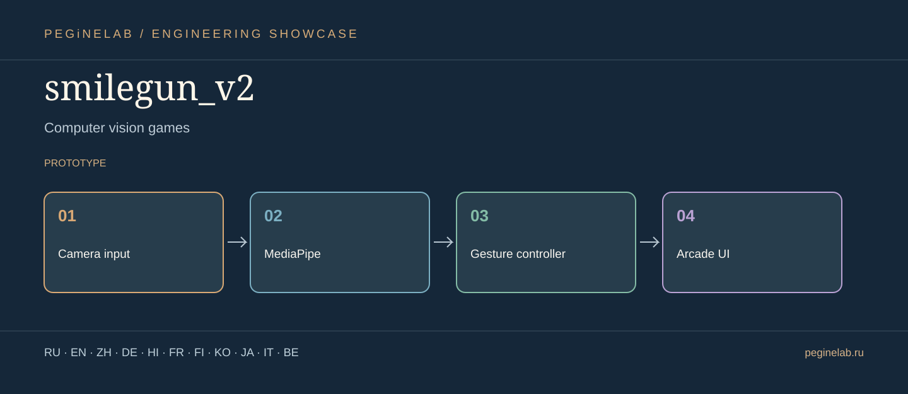

# smilegun_v2 · Graphical showcase

**Игры с компьютерным зрением / Computer vision games** · Camera input → MediaPipe → Gesture controller → Arcade UI · status: **prototype**.

**Internationalization scope:** these are translated descriptions, not a claim that the application's UI has eleven implemented languages. Features and limitations in the root README take precedence.

### Русский · ru
Аркадная игра с компьютерным зрением, жестами и мимикой.. **smilegun_v2** — Camera input → MediaPipe → Gesture controller → Arcade UI.

### English · en
Computer-vision arcade game using gestures and facial actions.. **smilegun_v2** — Camera input → MediaPipe → Gesture controller → Arcade UI.

### 简体中文 · zh
使用计算机视觉、手势与表情控制的街机游戏。. **smilegun_v2** — Camera input → MediaPipe → Gesture controller → Arcade UI.

### Deutsch · de
Arcade-Spiel mit Computer Vision, Gesten und Mimik.. **smilegun_v2** — Camera input → MediaPipe → Gesture controller → Arcade UI.

### हिन्दी · hi
कंप्यूटर विज़न, इशारों और चेहरे के भाव वाला आर्केड गेम।. **smilegun_v2** — Camera input → MediaPipe → Gesture controller → Arcade UI.

### Français · fr
Jeu d'arcade avec vision artificielle, gestes et expressions du visage.. **smilegun_v2** — Camera input → MediaPipe → Gesture controller → Arcade UI.

### Suomi · fi
Tietokonenäköön, eleisiin ja ilmeisiin perustuva arcade-peli.. **smilegun_v2** — Camera input → MediaPipe → Gesture controller → Arcade UI.

### 한국어 · ko
컴퓨터 비전, 제스처, 표정으로 조작하는 아케이드 게임.. **smilegun_v2** — Camera input → MediaPipe → Gesture controller → Arcade UI.

### 日本語 · ja
コンピュータービジョンゲーム. **smilegun_v2** — Camera input → MediaPipe → Gesture controller → Arcade UI.

### Italiano · it
Giochi di visione artificiale. **smilegun_v2** — Camera input → MediaPipe → Gesture controller → Arcade UI.

### Беларуская · be
Гульні з камп'ютарным зрокам. **smilegun_v2** — Camera input → MediaPipe → Gesture controller → Arcade UI.

## Contact / Контакты

[Telegram @Feudorlab1](https://t.me/Feudorlab1)

[feudor.lab@yandex.ru](mailto:feudor.lab@yandex.ru) · [obzorniky@gmail.com](mailto:obzorniky@gmail.com) · [peginelab.ru](https://peginelab.ru/)

[Source repo](https://github.com/musikfed/smilegun_v2)
